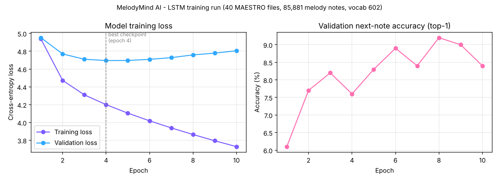

# 🎵 MelodyMind AI – Intelligent Music Composition Studio

**🔗 Live demo:** https://melodymind-ai-qhza2q8yxlsakpp3ly83hn.streamlit.app  
**📦 Source:** https://github.com/AmanGupta-ai143/MelodyMind-AI  
_(The free demo may take ~30 s to wake up. Saved compositions are not kept after the app restarts.)_

An LSTM-based music generator with a Streamlit studio UI, built as an **Artificial Intelligence internship project**
(task: *Music Generation with AI*).

The model is **trained on real MIDI files** and every generated note is **predicted by the trained network** – nothing is
picked from a folder of pre-made songs.

## Problem statement
Can a neural network learn musical patterns from existing MIDI files and use them to compose new melodies?

## Objectives
- Process MIDI data into numeric sequences suitable for an RNN
- Train an LSTM to predict the next note
- Generate new melodies with temperature sampling and export them as MIDI / WAV
- Provide an interactive dashboard with real training and dataset analytics

## Features
| Page | What it does |
|---|---|
| Dashboard | KPIs, training loss, note/instrument distribution, recent compositions, activity |
| AI Music Generator | Instrument, number of notes, temperature, seed; piano roll, playback, MIDI/WAV download, save |
| Dataset Explorer | Real dataset statistics, file list, preview (piano roll + audio), licence & attribution |
| Model Training Center | Process dataset, set epochs / batch size / sequence length / learning rate, live loss, checkpointing |
| Music Library | Saved compositions, favourites, download, delete (SQLite) |
| Playback Studio | Player + piano roll for a saved composition |
| Training Analytics | Loss, perplexity and next-note accuracy per epoch, training history table |
| About | Method, technologies, limitations |

**Honesty notes:** genre and mood are saved as *tags only* – the LSTM is not conditioned on them. The charts show only real data
(empty states are shown when there is none). "Accuracy" is never used for loss; next-note top-1 accuracy is shown separately.

## Tech stack
Python · PyTorch (LSTM) · PrettyMIDI · NumPy · Pandas · Streamlit · Plotly · SQLite · (optional) FluidSynth

## Dataset, licence and attribution
Default: **MAESTRO v3.0.0** MIDI files (Google Magenta) – <https://magenta.tensorflow.org/datasets/maestro>,
licensed **CC BY-NC-SA 4.0** (attribution, non-commercial, share-alike). A random subset (default 150 files) is used.
The dataset is **not** committed to this repo; `scripts/download_dataset.py` fetches it. You may also place any `.mid` files you
have the right to use in `data/midi_dataset/`.

> C. Hawthorne et al., "Enabling Factorized Piano Music Modeling and Generation with the MAESTRO Dataset", ICLR 2019.

## Architecture
```
 previous N notes (ids)
        │
   Embedding(vocab, 64)
        │
   LSTM(256)  ──► Dropout(0.3) ──► LSTM(256)
        │
   Dense(vocab)  →  Softmax(logits / temperature)  →  next note
```
A token is `(pitch, duration bucket)`; durations are snapped to {0.125, 0.25, 0.375, 0.5, 0.75, 1, 1.5, 2} seconds.

## Workflow
**Data:** MIDI → validate → extract notes → monophonic "skyline" melody → tokens → ids → sliding windows (N notes → next note)  
**Training:** windows → LSTM → cross-entropy loss → Adam update → validation each epoch → save best checkpoint  
**Generation:** load checkpoint → seed with a short real passage → predict next note (temperature sampling) → repeat → MIDI → WAV → play / download

## Installation
```bash
git clone https://github.com/<your-username>/MelodyMind-AI.git
cd MelodyMind-AI
python -m venv .venv && source .venv/bin/activate      # Windows: .venv\Scripts\activate
pip install -r requirements.txt
```

## Running
```bash
python scripts/download_dataset.py --count 150          # 1. get MIDI data
python -m music_processing.preprocessing --max-files 150 # 2. build training data
python -m models.train --epochs 30                      # 3. train (or use the Training page)
streamlit run app.py                                    # 4. open the studio
```
Run the tests: `pytest`

Optional better audio: install FluidSynth + `pip install pyfluidsynth`, download a General-MIDI `.sf2`, and set the `SOUNDFONT`
environment variable. Without it, a simple built-in synthesiser renders the WAV.

## Results
Real training run (CPU, 10 epochs, hidden size 128, sequence length 32) on **40 MAESTRO MIDI files**
(85,881 melody notes, vocabulary of 602 note tokens):

| Metric | Value |
|---|---|
| Training loss (epoch 1 → 10) | 4.94 → 3.73 |
| Best validation loss (epoch 4, saved checkpoint) | **4.695** |
| Validation next-note accuracy (top-1) | about 8–9 % |
| Random-guess baseline (1 / 602) | about 0.17 % |



The model clearly learns musical patterns (accuracy ≈ 50× above chance), but validation loss rises after epoch 4 –
a sign of overfitting on this small subset. Training on more files and using more dropout are the obvious next steps.
Next-note accuracy is a rough guide only; music has no single "correct" continuation.

## Screenshots
Add your own screenshots to `docs/` (Dashboard, Generator, Dataset Explorer, Training Analytics) and link them here.

## Sample compositions
Generate a piece in the app, download the MIDI file and place it in `samples/`.

## Limitations
- Monophonic melodies only; rests, velocity and chords are not modelled
- Quality depends on dataset size and training time (a small CPU-trained model produces simple, sometimes repetitive music)
- Genre/mood are tags, not controls
- Built-in synth is basic; use a SoundFont for realistic sound

## Future improvements
Polyphonic encoding · conditional generation (genre/mood) · Transformer or GAN models · beam/top-k/nucleus sampling · better rendering

## Project structure
`app.py` (navigation) · `pages/` (UI) · `models/` (LSTM, train, generate) · `music_processing/` (MIDI → tokens) ·
`services/` · `database/` · `components/` · `tests/` · `scripts/`

## Deployment (Streamlit Community Cloud)
Deployed from this repository (`main` branch, `app.py`). The trained checkpoint and processed data are committed
(force-added with `git add -f`) so the app can generate music without retraining. On the free tier the MIDI dataset is not
present, so the Dataset Explorer shows statistics but no file preview, FluidSynth is unavailable (the built-in synthesiser
renders audio) and the SQLite library resets when the app restarts. Train locally and push the new checkpoint to update the model.
